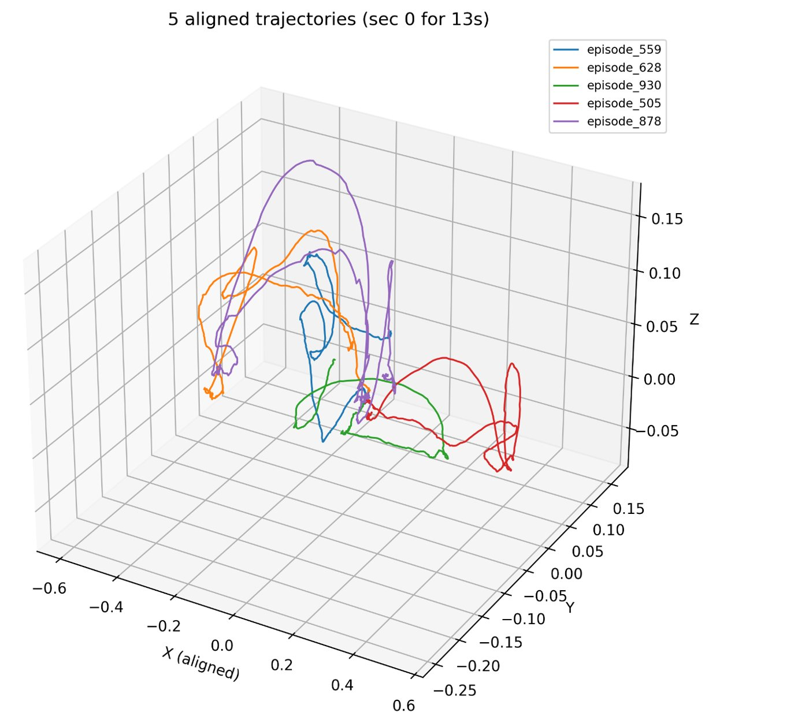
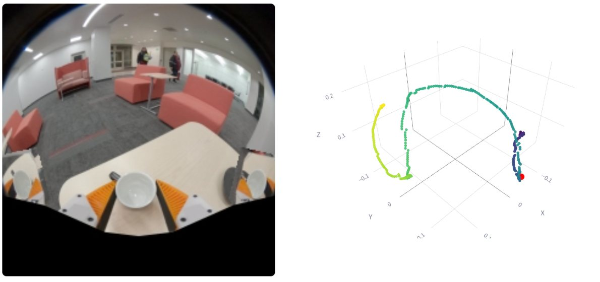
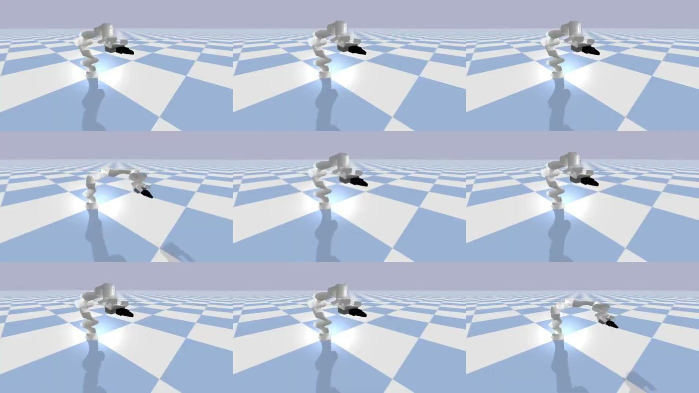
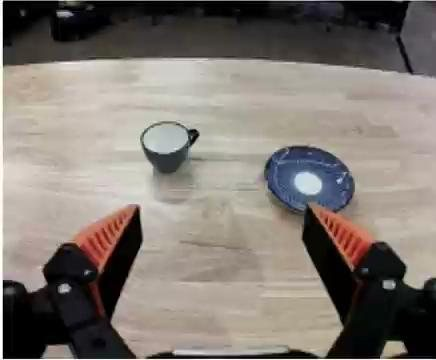

*An ongoing project, started at the [Robotics and AI Institute](https://theaiinstitute.com/). This page is a snapshot; more details soon.*

Once our handheld data collection scaled to [hundreds of hours](/projects/umi-capture), the bottleneck moved. The question was no longer *how much* data we had, but *which* of it was worth training on. I built a curation pipeline to answer that automatically for every episode, before it reached a policy. Combined, its three layers improved policy success rate by about **20% on high-accuracy tasks**.

## Why "good data" is hard to pin down

There is no single definition of a good demonstration. A clip can complete the task and still be a poor training example: too fast for the robot to follow, full of hesitation, or solved in a way no other collector would solve it.

Data from a [UMI-style](https://umi-gripper.github.io/) handheld gripper makes this harder. The device is fully mobile and the person holding it has no robot attached, so nothing stops them from moving faster, reaching further, or taking a stranger path than the robot ever could. The freedom that makes UMI collection cheap is the same thing that makes its data noisy.

<figure class="fig-narrow">
  
  <figcaption>Five demonstrations of the same task, aligned at the start. Each one takes a visibly different path through space.</figcaption>
</figure>

I broke the problem into three questions, from cheapest to hardest to answer: Is the episode clean? Can the robot physically execute it? Does it agree with the rest of the dataset?

<figure>
  
  <figcaption>Inspecting a single episode: the wrist-camera frame (left) next to the recorded end-effector trajectory (right). Looking at many of these by hand is what shaped the automatic checks below.</figcaption>
</figure>

## Is the episode clean? Motion heuristics

The first layer is a set of simple signals computed per episode:

- **Jerkiness.** Sharp, shaky motion is hard for the robot to track, and a policy trained on it learns to reproduce the shake.
- **Pauses.** Long stretches where the collector hesitates add frames in which nothing happens. They teach the policy that standing still is a reasonable action for that observation.
- **Motion blur.** Fast hand motion blurs the wrist camera, which corrupts exactly the observations the policy relies on.

Episodes that fail these checks are dropped. The checks are cheap and easy to interpret, which makes them a good first pass. They don't tell you whether the robot can do what the human did, or whether the human did it the same way as everyone else.

## Can the robot do this? Chunk-level replay in simulation

A person has a much larger workspace than the arm, and much higher velocity and acceleration limits. In practice, most human episodes could not be replayed on the robot from start to finish. Somewhere in the clip there is usually a reach that is out of range or a motion that is too fast.

Rejecting every such episode would have thrown away most of the dataset, including long stretches that are perfectly feasible. So instead of asking "can the robot replay this episode?", we ask "can the robot replay this chunk?". We replay each action chunk of each episode in simulation and check that it is reachable (inverse kinematics), stays within joint limits, respects the arm's velocity and acceleration limits, and is collision-free. Every time index that passes is marked valid, and training samples only from valid indices.

<figure>
  
  <figcaption>Replaying human demonstrations chunk by chunk in simulation to find the segments the robot can execute.</figcaption>
</figure>

Chunk-level filtering matches how the policy is trained. A diffusion policy never sees a whole episode at once; it learns to predict a short chunk of actions from the current observation. So feasibility only needs to hold at that same granularity. An infeasible reach in the middle of an episode should cost us those few seconds, not the whole episode.
## Does it agree with the rest? Dataset-level consistency

The subtlest problem is not in any single episode. It is in how episodes relate to each other.

Diffusion policies are popular for imitation learning partly because they can represent multi-modal behavior. If half the demonstrations go around an obstacle on the left and half go right, a diffusion policy can in principle learn both modes instead of averaging them into a path straight through the obstacle. In practice, we still saw policies suffer when demonstrations were inconsistent.

<figure>
  

    
    
  

  <figcaption>Wrist-camera views from two demonstrations of the same cup-and-saucer task.</figcaption>
</figure>

My reading of why: being able to represent several modes is not the same as having enough data to learn each one well. Every new collector brings their own way of doing the task, so the data splits into many small styles rather than a few clean modes. Each style gets only a fraction of the demonstrations, and nothing in a single observation tells the policy which style it is in, so it can switch between them from one chunk to the next.

So the third layer **scores the consistency of a dataset**, and it uses the policy itself as the judge. We train a policy on the dataset, then score every action chunk by how well that policy explains it: its likelihood, or equivalently its training loss on that chunk. A chunk the policy fits easily agrees with how most demonstrators did the task. A chunk it keeps struggling to fit is one the rest of the data argues against.

Scoring per chunk rather than per episode follows the same logic as the feasibility check. A demonstration can be perfectly typical for most of its length and idiosyncratic for one grasp, and we'd rather lose the grasp than the episode.

This is close in spirit to work on [eliciting compatible demonstrations](https://arxiv.org/abs/2210.08073) (Gandhi et al., CoRL 2022), which measures how compatible a new demonstration is with a policy trained on existing data. Our setting is after the fact: the data is already collected, and the question is what to keep. That paper also points at the main subtlety. A chunk can be hard to fit because it *conflicts* with the rest of the data, or because it is *novel*: a rare but valid situation the dataset covers thinly. A loss-based score alone can't tell those apart, and separating them is part of what I'm still working on.

The early result is encouraging. On some datasets collected by multiple people, training on the 50% of the data with the best consistency scores matched the performance of training on all of it.

## What's next: curriculum training

Matching full-dataset performance with half the data shows the consistency score is picking up something real. On its own, though, cutting data only saves compute; the goal is better policies. The next step is curriculum training: using the score to order or weight the data during training, rather than only to cut it. That way, novel but valid chunks stay in the mix instead of being thrown away with the conflicting ones.

## What I've learned so far

- **More data is not automatically better data.** On multi-collector datasets, the half we filtered out added little on top of the consistent half. Which demonstrations you keep can matter as much as how many you have.
- **Filter at the granularity the policy trains on.** Whole-episode accept/reject is too blunt for human data. Chunk-level checks keep the good parts of imperfect episodes.
- **The policy is a useful judge of its own data.** How hard a chunk is to fit says a lot about whether it belongs, as long as you remember that "hard to fit" can also mean "rare and valuable".
- **Multi-modal models still prefer consistent data.** Expressive policy classes reduce the cost of disagreement between demonstrators, but they don't remove it.
- **Handheld data needs a feasibility check that teleoperation data doesn't.** With teleop, the robot's limits are enforced while you collect. With UMI, you have to enforce them afterward.
