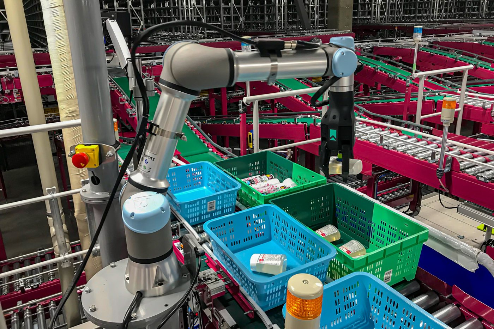
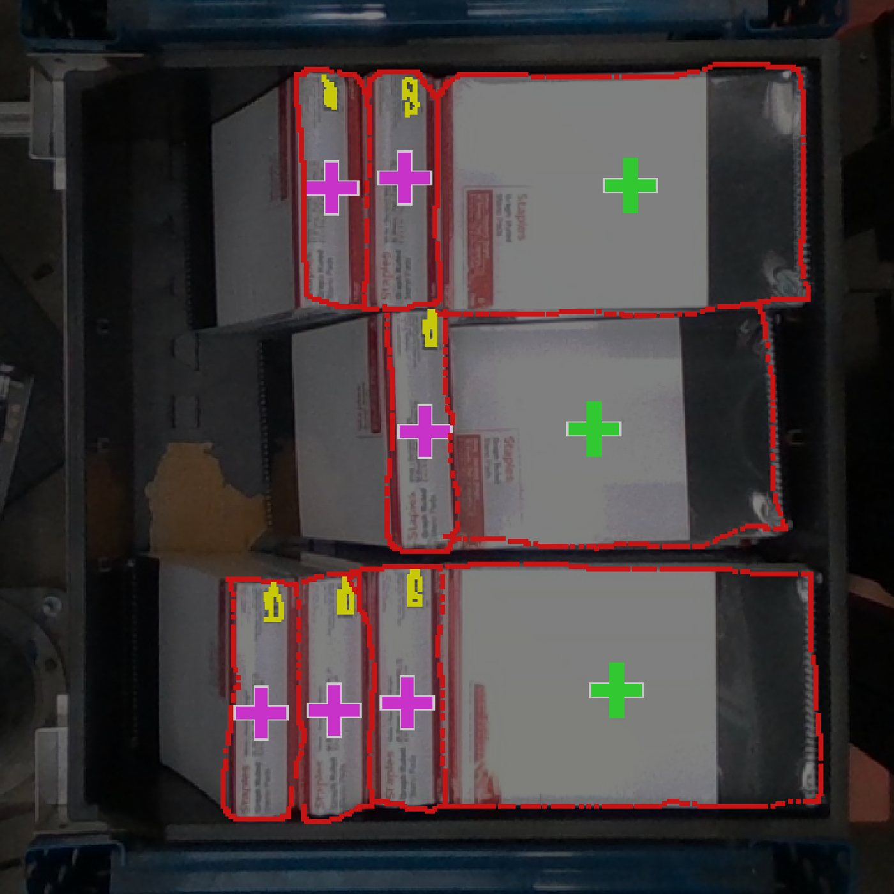
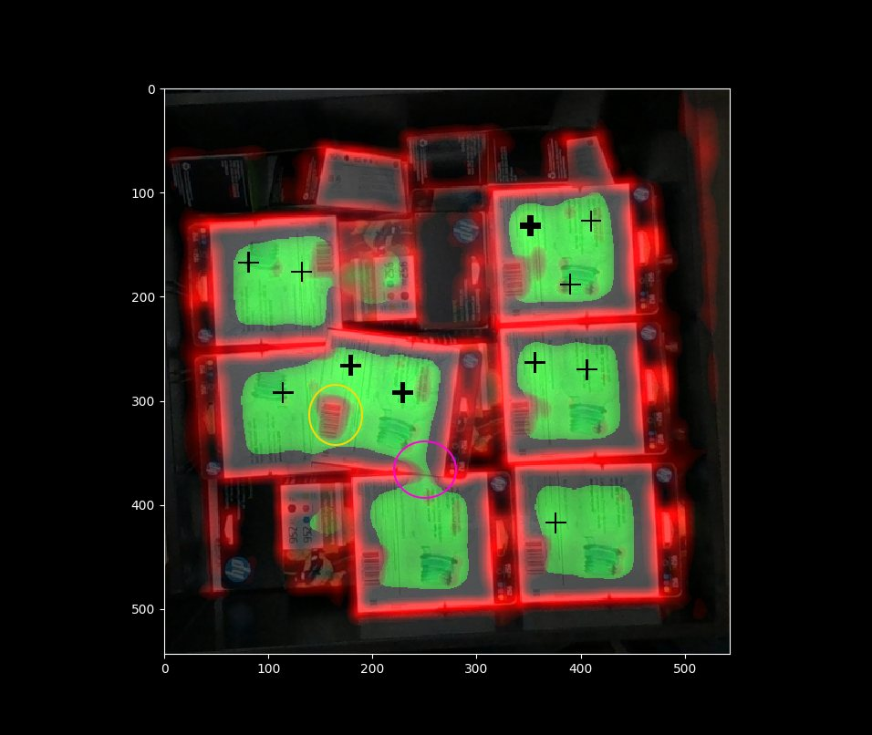
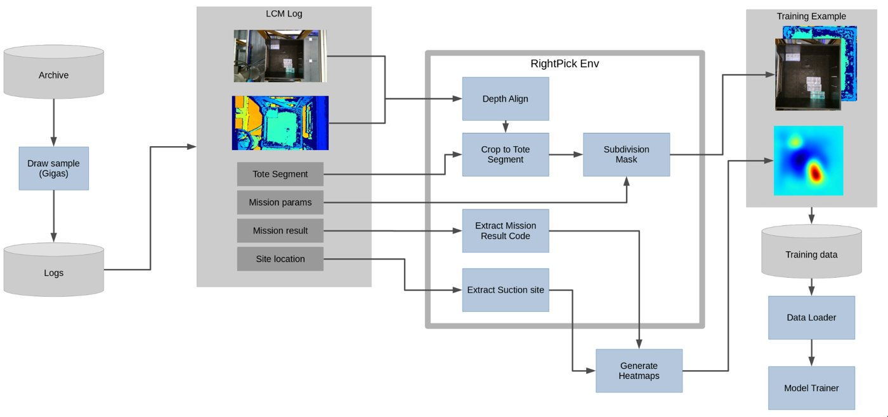
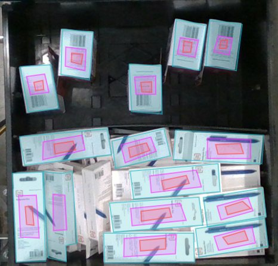
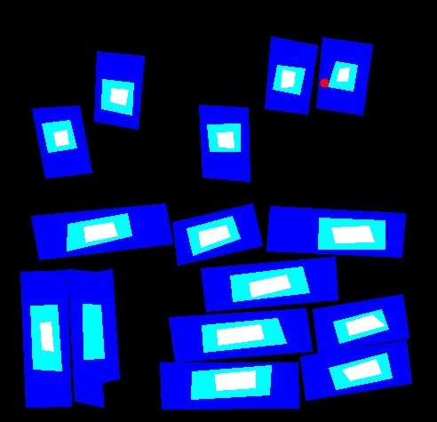
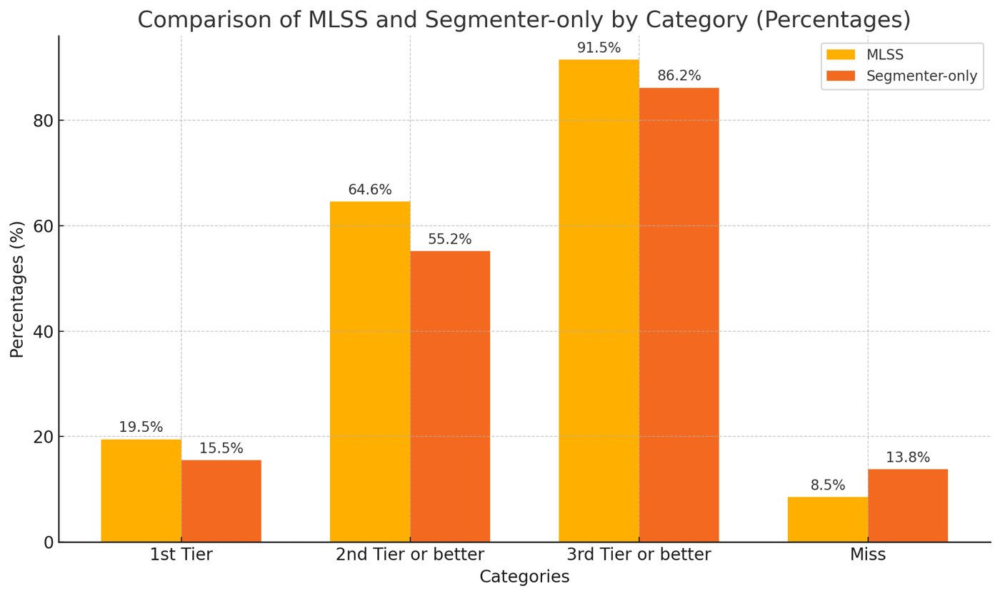

At [RightHand Robotics](https://righthandrobotics.com/), I led the development of the company's first end-to-end visuomotor picking policy for warehouse piece-picking. The new policy replaced a segmentation-based pipeline that had been in production for years.

<figure>
  
</figure>

## The problem

The production system segmented each item, then used hand-tuned post-processing to choose a suction site. It worked well for years, but several problems persisted:

- **Labeling is expensive.** Instance segmentation masks are slow and hard to annotate consistently.
- **Multi-picks.** Tightly packed items leave thin margins between them, and suction sites near those margins often lift two items at once.
- **Brittle assumptions.** Post-processing rules (e.g. "pick near the centroid") break on cluttered bins and irregular items.

Could a policy instead predict suction sites directly from RGB-D, the way a person just looks and picks? This makes annotation easier and removes the hand-tuned assumptions. The risk is that no pretrained model fits the task, so it might need a lot of data.

## Bootstrapping from labels

We started with about 2,000 hand-labeled images. Annotators marked the *best* and *good* suction sites, the margins between items, and areas to avoid. The model predicts both a "good site" heatmap and a "bad site" heatmap and fuses them, so suction sites near margins are actively penalized.

<figure>
  

    
    
  

  <figcaption>Left: manual labels, with best sites in green, good sites in pink, and margins in red. Right: the fused heatmap the model predicts.</figcaption>
</figure>

## Scaling with production logs

Hand labels don't scale. Every production pick, however, is logged with sensor data, the chosen suction site, and its outcome. I built a pipeline that pulls these logs from the archive, aligns depth, crops to the tote, and converts successful suction sites into dense heatmap targets (circular blobs, to strengthen the training signal). The first log-mined training set had 23k image–suction-site pairs. The archive behind it later grew to over 200,000 missions.

<figure>
  
  <figcaption>From archived production logs to training examples.</figcaption>
</figure>

## Designing the evaluation

Comparing the new policy against the old one turned out to be a problem of its own. Standard metrics like IoU don't apply, because the segmenter-based system outputs a single point and the new policy outputs a heatmap. I proposed a **tier-based benchmark**: 200 images covering a range of layouts and item categories, each hand-labeled with three tiers of acceptable suction areas, from ideal to merely acceptable. Each system's chosen site is scored by the tier it lands in.

<figure>
  

    
    
  

  <figcaption>Tier-based labels: each item has nested regions from best (tier 1) to acceptable (tier 3).</figcaption>
</figure>

<figure>
  
  <figcaption>The learned policy (yellow) beat the segmenter at every tier and cut misses from 13.8% to 8.5%.</figcaption>
</figure>

## Results in deployment

In production, tote images from both systems were labeled double-blind. Compared with the segmenter-based system, the end-to-end policy had:

- **8% higher pick success** on unseen items
- **30% lower trash-pick rate**

The deployed policy kept improving on new data from production, and this loop surfaced failure modes we could never have anticipated in the lab.
