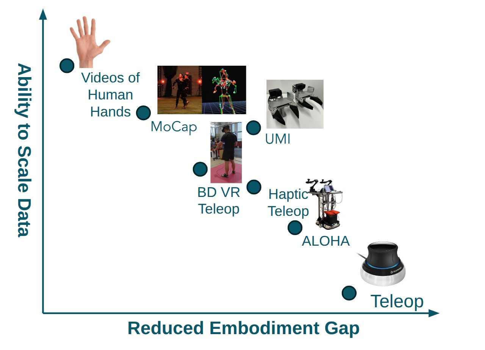
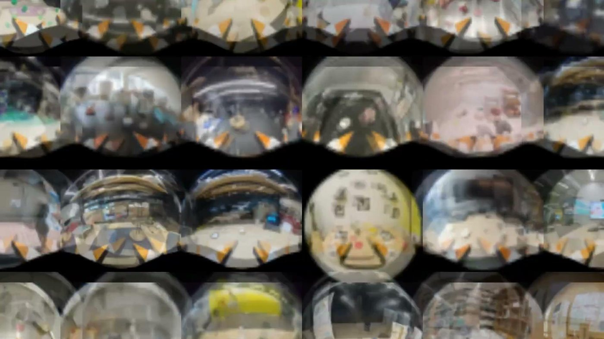
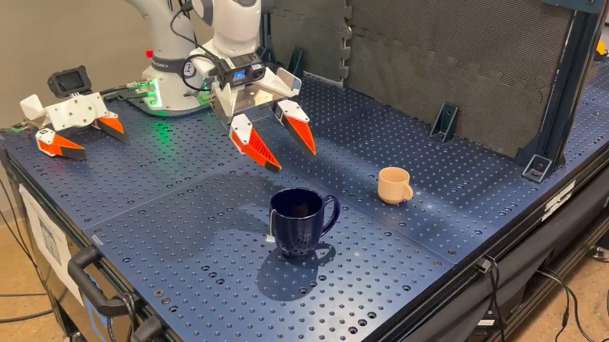
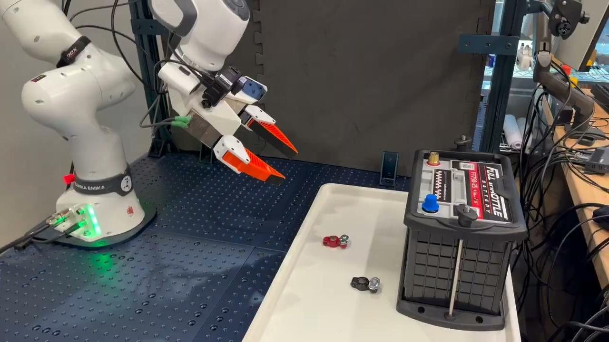
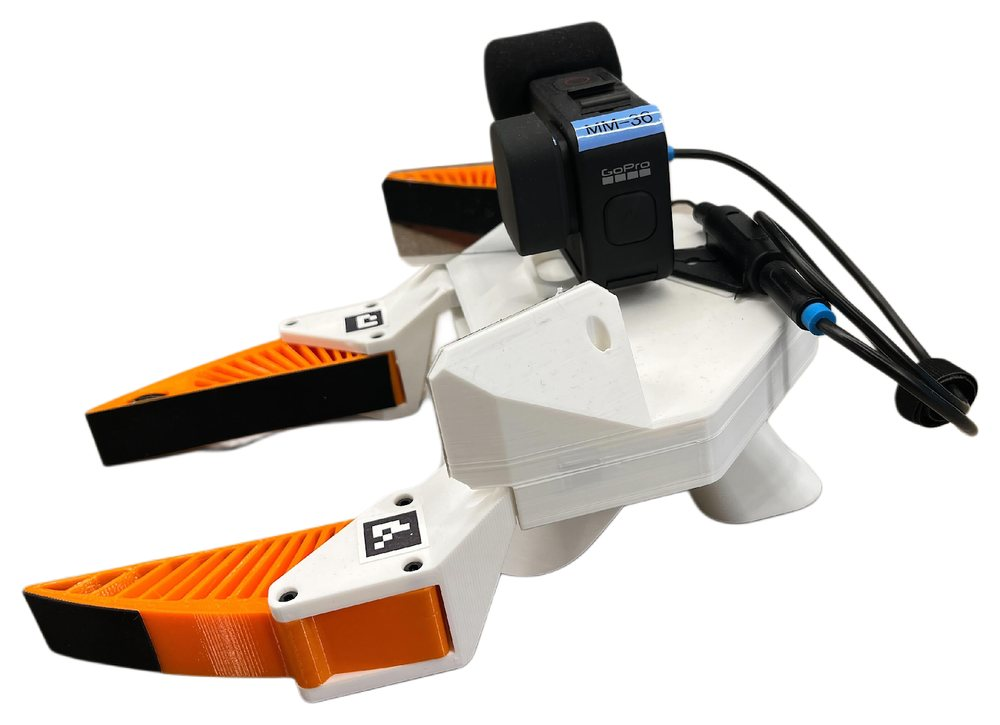
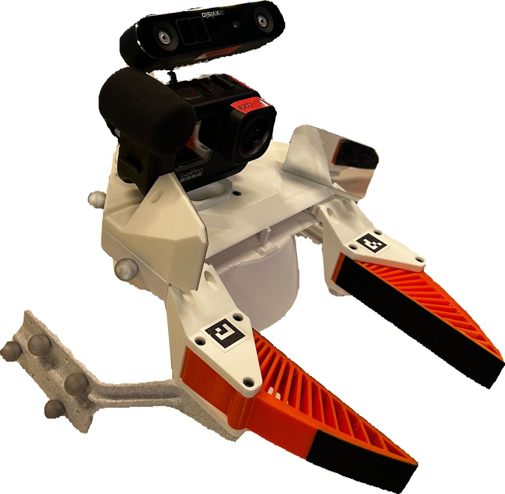
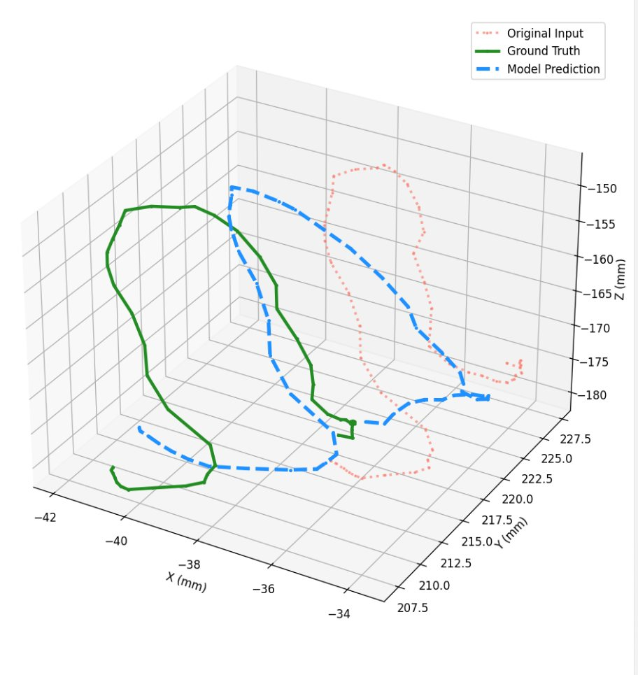
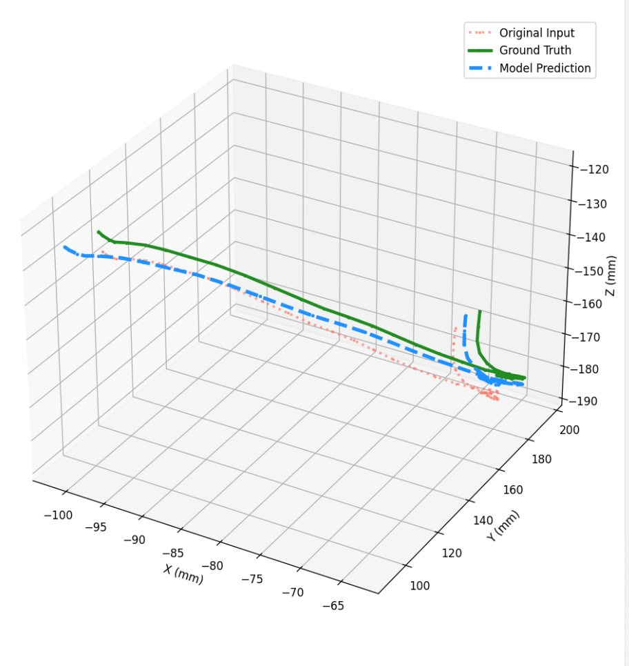

At the [Robotics and AI Institute](https://theaiinstitute.com/), our team set out to collect large amounts of real-world manipulation data *without a robot*, and then train robot policies on it. We built on [UMI](https://umi-gripper.github.io/): a person carries a handheld gripper that mirrors the robot's, with a wrist camera, and the gripper's pose is tracked so every demonstration becomes a trajectory a robot arm can learn from.

The collection pipeline, hardware, and robot stack were a team effort. My part was the data itself: [curating and evaluating it](/projects/data-quality), and training the residual model described below that corrects the gripper's pose tracking.

## Why handheld grippers

Every way of collecting robot data trades off two things: how easily it scales, and how closely the data matches the robot's own body (the *embodiment gap*). Videos of human hands are nearly free to collect, but a hand is not a parallel-jaw gripper, and the camera is nowhere near the robot's. Teleoperation produces exactly the data the robot needs, but it requires a robot for every operator, and an hour of teleop costs an hour of robot time.

<figure class="fig-narrow">
  
  <figcaption>Data collection methods range from human videos (most scalable) to teleoperation (smallest embodiment gap).</figcaption>
</figure>

A UMI-style gripper sits in a useful middle. The fingers and wrist camera match the robot's, so the policy sees the same kind of images at test time as in training. But it needs no robot, so anyone can carry one into a kitchen or a workshop. The price is that nothing measures the gripper's pose directly. It has to be estimated, and that estimate *becomes the action label* the policy learns from. That cost comes back later on this page.

## A pipeline from protocol to robot

Building on UMI, we collected and processed more than **200 hours** of demonstrations across many environments. To make that repeatable, we ran each new task through the same loop:

<figure>
  

    
<strong>1. Protocol</strong> Write the task protocol and run a small trial collection.

    
<strong>2. Collect</strong> Set randomization, locations and episode targets, then collect at scale.

    
<strong>3. Process</strong> Recover gripper poses with SLAM, curate, and store queryable episodes.

    
<strong>4. Train</strong> Train a flow-matching or diffusion policy from scratch, or LoRA-fine-tune a VLA.

    
<strong>5. Evaluate</strong> Run the policy on the robot. Results shape the next protocol and the next hardware revision.

  

  <figcaption>The collection loop. Each robot evaluation fed back into both the task protocol and the gripper design.</figcaption>
</figure>

The loop mattered more than any single step. A trial collection catches a bad protocol before it costs a hundred hours, and robot evaluations tell you what the data is missing, which is often something you can only fix in the next collection or in the hardware. The team has since taken the hardware side of this loop further with the [Koala Gripper](https://koalagripper.rai-inst.com/), which co-designs the robot gripper and the handheld capture device together.

<figure>
  
  <figcaption>Wrist-camera views from the collected episodes, across many environments.</figcaption>
</figure>

## Running the policies on a real robot

We deployed diffusion policies on a Franka arm. A diffusion policy predicts a short chunk of future actions at a time, and how often you can afford to predict a new chunk turns out to matter a lot.

At first, the policy produced a new chunk every **0.6 seconds**. Running it faster made the arm *jerkier*, not better, because each new chunk was sampled independently and could disagree with where the arm was already heading. Every switch between chunks became a visible kink.

**Real-time action chunking** fixed this. When sampling the next chunk, the actions the robot has already committed to are held fixed, and the model fills in the rest by inpainting. The new chunk is then a continuation of the old one rather than a fresh guess. With that, the policy ran at **15 Hz**, 9× more often, and moved more smoothly instead of less. (Our evidence here is qualitative: rollouts looked and behaved better; we didn't benchmark it separately.)

<figure>
  

    
    
  

  <figcaption>Robot rollouts of policies trained only on handheld demonstrations. The battery-terminal task (right) is one of our delicate tasks.</figcaption>
</figure>

That 15 Hz number matters again at the end of this page.

## The 6 mm problem

The original UMI tracks the gripper with monocular SLAM on its fisheye camera. Outside-in tracking, such as a motion-capture room, is far more accurate, but it ties collection to one instrumented space, which defeats the point. We added a stereo-inertial tracking camera to the gripper. Its mean translational error was still about **6 mm**. Teleoperation, by contrast, records the robot's own joint encoders and is accurate to well under a millimeter.

<figure>
  

    
    
  

  <figcaption>Left: a camera-only gripper, as in the original UMI. Right: our gripper with a stereo-inertial tracking camera and motion-capture markers.</figcaption>
</figure>

Six millimeters sounds small, but for a delicate task it can be the whole margin: the clearance around a battery terminal, or the gap between a fingertip and the edge it needs to catch. And not all tracking error is equal. Random noise tends to average out across many demonstrations. A *systematic* error, such as the tracker consistently reporting the gripper a few millimeters too high, does not; a policy will learn it faithfully.

## Turning a mocap room into a label factory

Mocap is usually used to *evaluate* a tracker. We realized it could do more: with enough data, it could supervise a model that *fixes* the tracker. A robot arm couldn't play that role, because it can't follow the full range of motion of a hand-held device. But we already had motion-capture rooms, originally built for humanoid work.

So we built a version of the gripper that carries mocap markers alongside the tracking camera, and collected about **4,000 demonstrations** in the mocap space with ground-truth poses, covering different settings and motion dynamics.

## A residual model on pose alone

I trained a **residual transformer** that takes a SLAM trajectory of 128 poses and predicts a correction for each pose, supervised by the mocap ground truth. Three design choices shaped it:

- **Residual, not end-to-end.** SLAM is already right to within millimeters. Predicting a small correction on top of it is a much easier learning problem than estimating pose from scratch, and the output can never stray far from a physically plausible trajectory.
- **State only, no vision.** Inspired by how a smartwatch infers motion from its own sensor stream, the model sees only the pose trajectory. That keeps it small and fast, and it can't latch onto what a particular room looks like, which matters when it is trained in one mocap space but used everywhere.
- **Hierarchical.** The model first predicts one offset for the whole trajectory, then a per-step offset. This split matches the two kinds of error: a bias that shifts the entire trajectory, and noise that varies from step to step.

<figure>
  

    
    
  

  <figcaption>Red: raw SLAM. Green: mocap ground truth. Blue: after residual correction. Axes in millimeters.</figcaption>
</figure>

The correction reduced localization error by **30% on tasks seen in training and 15% on unseen tasks**. It mostly learned to remove systematic biases, such as a consistent offset in height, and to smooth noisy trajectories. The natural next step is to feed the model the IMU stream and vision, which a state-only model leaves on the table.

Retraining policies on the corrected data paid off where precision matters: **on delicate tasks, success went from 20% to 45%.**

## Why a robot can beat its own data

The most interesting thing I took from this project wasn't the correction model. It was a pattern in the rollouts: the robot often performed tasks *more accurately than the demonstrations it was trained on*. If the labels are off by millimeters, how does the policy end up closer than that?

My explanation is that the policy doesn't need its labels to be precise. It needs them to point the right way.

My working assumption is that pose-tracking errors corrupt mostly the *magnitude* of each action, "move 9 mm" recorded as "move 12 mm", while the *direction*, toward the handle or down onto the terminal, stays right. A policy trained on that data learns a reliable direction and a noisy step size. Run open loop, a wrong step size is fatal: you overshoot and never find out. Run closed loop at high frequency, it barely matters. The policy takes a step, sees where the gripper actually ended up, and predicts again from there.

A one-line model shows why. Say the gripper is *e* away from the target, and each step moves it *k·e*, where *k* should be 1 but is off because of label noise. After one step the error is (1 − *k*)·*e*. As long as *k* stays between 0 and 2, so that the direction is right and the step isn't wildly too large, the error shrinks geometrically with every iteration. A 30% error in step size still converges, just in an extra step or two. The scale error never accumulates, because every new observation resets it.

This is the same predict-then-correct structure as a Kalman filter. The learned policy supplies the prediction, the camera supplies the measurement, and running the loop fast lets the measurement keep pulling the estimate back toward the truth. It is also why the move from 0.6 s to 15 Hz mattered beyond smoothness. At 0.6 s per chunk, each prediction runs open loop for longer and its scale errors have time to build up. At 15 Hz, they are corrected almost as soon as they appear.

The loop has limits, and they explain why the residual correction still mattered. Closed-loop feedback forgives errors in *how far* to move. It can't fully forgive a consistent error in *where* the target is, because the policy has learned to aim at the wrong place. On loose tasks that bias hides inside the tolerance. On delicate tasks it is the failure, which is consistent with where the corrected data helped most.

I think this is worth studying properly. If it holds up, then for handheld data, *directional* consistency of the labels matters more than their absolute accuracy, and inference speed is part of data quality.

## What I learned

- **Label accuracy matters most where tolerance is tight.** For robot-free data, the pose estimate *is* the action label. Correcting a few millimeters of tracking error more than doubled success on delicate tasks.
- **Bias is worse than noise.** Policies average out random error and closed-loop control forgives scale error, but a consistent offset gets learned. A correction model earns its keep by removing the bias.
- **Fast closed loops make imperfect data go further.** A policy that predicts the right direction and re-plans quickly can end up more precise than its demonstrations.
- **Expensive infrastructure can become a data source.** A mocap room built for humanoid work became a way to produce thousands of supervised examples for a different problem.

Making the data precise was half the problem. Deciding which of it to train on is the other half, covered in [Data Quality Evaluation](/projects/data-quality).
